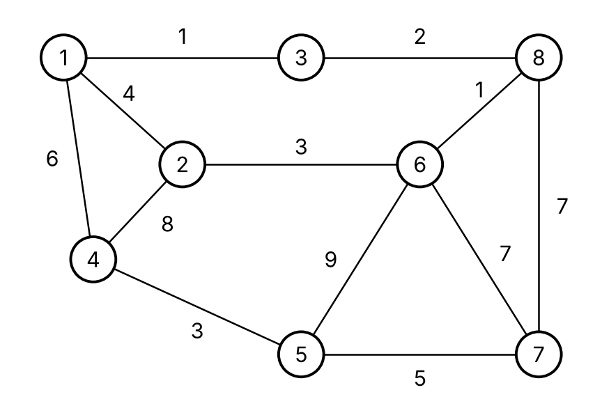
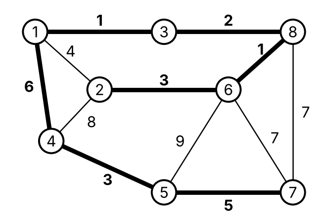

# Лабораторна робота № 5 — Алгоритми на графах. Мінімальне кістякове дерево

## Варіант 22

Вхідні дані: зважений неорієнтований граф, `|V| = 8`, `|E| = 12`



Ребра графа: `(1,3)=1, (3,8)=2, (1,2)=4, (1,4)=6, (2,6)=3, (2,4)=8, (6,8)=1, (5,6)=9, (6,7)=7, (7,8)=7, (4,5)=3, (5,7)=5`

Результат: мінімальне кістякове дерево `{(1,3), (3,8), (6,8), (2,6), (1,4), (4,5), (5,7)}`, загальна вага **21**.
Алгоритми Пріма та Крускала дають однакове дерево, але додають ребра в різному порядку.

## Структура репозиторію

| Файл | Опис | Відповідає у звіті |
|---|---|---|
| `prim.cpp` | Алгоритм Пріма (граф поданий матрицею суміжності, старт з вершини 1) | Лістинг 5.2, лістинг 5.3, таблиця 5.3 |
| `kruskal.cpp` | Алгоритм Крускала (список ребер + система неперетинних множин DSU) | Лістинг 5.5, лістинг 5.6, таблиця 5.5 |
| `images/graph.png` | Граф варіанта 22 | Рисунок 5.1 |
| `images/adjacency_list.png` | Список суміжності графа | Рисунок 5.2 |
| `images/prim_mst.png` | МКД, побудоване алгоритмом Пріма | Таблиця 5.6 |
| `images/kruskal_mst.png` | МКД, побудоване алгоритмом Крускала | Таблиця 5.6 |
| `ЛР5_22_АІ254_Церковний_Олександр.docx` | Звіт з лабораторної роботи | — |
| `ЛР5_22_АІ254_Церковний_Олександр.pdf` | Звіт у форматі PDF | — |

## Запуск

Потрібен компілятор C++ (g++ або будь-який інший), сторонні бібліотеки не потрібні.

```bash
g++ prim.cpp -o prim
./prim

g++ kruskal.cpp -o kruskal
./kruskal
```

## Результати виконання

**Алгоритм Пріма** (`prim.cpp`):

```
Edge : Weight
1 - 3 :  1
3 - 8 :  2
8 - 6 :  1
6 - 2 :  3
1 - 4 :  6
4 - 5 :  3
5 - 7 :  5
Total weight: 21
```

**Алгоритм Крускала** (`kruskal.cpp`):

```
Edge : Weight
1 - 3 :  1
6 - 8 :  1
3 - 8 :  2
2 - 6 :  3
4 - 5 :  3
5 - 7 :  5
1 - 4 :  6
Total weight: 21
```

| Алгоритм Пріма | Алгоритм Крускала |
|---|---|
|  |  |

